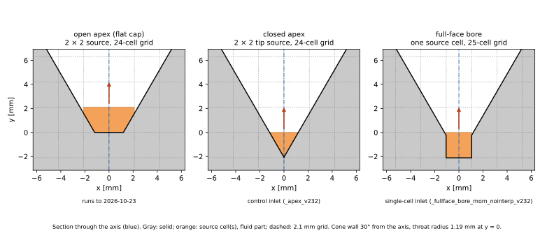
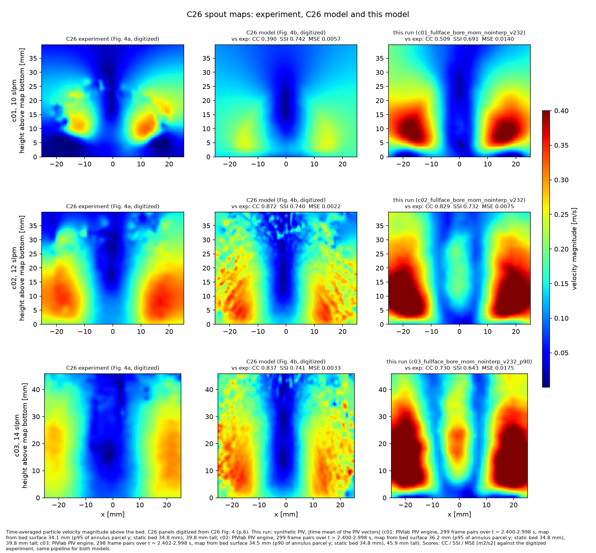
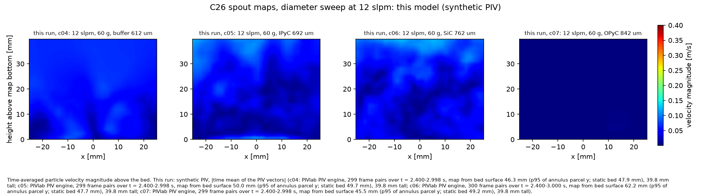
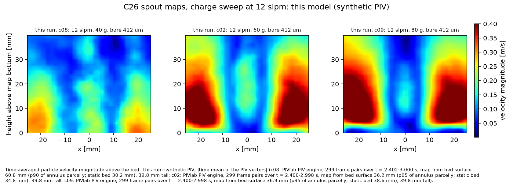

# TRISO-CFD

A cold-flow CFD model of the spouted bed used to coat TRISO nuclear fuel
particles. It is built in [MFiX](https://mfix.netl.doe.gov/) and
benchmarked against the ORNL benchtop experiment and model of [Conry et
al. 2026](https://www.sciencedirect.com/science/article/abs/pii/S002954932600261X)
("C26").

TRISO particles get their four coating layers in a conical **spouted
bed**. A gas jet from a nozzle at the cone's apex carries particles up a
central **spout** into a **fountain** above the bed. They fall back onto
the **annulus**, which slides down the cone wall to the nozzle again.
Coating uniformity depends on how evenly particles cycle through the
spout and fountain. This project models that particle motion; it has no
chemistry and no heat transfer.

## What is simulated

The benchmark is C26: Conry, Dal Forno Chuahy, Oyedeji, Finney, Heldt &
López-Honorato, [*Nucl. Eng. Des.* 456:115009
(2026)](https://www.sciencedirect.com/science/article/abs/pii/S002954932600261X). The rig is a 60° glass
cone opening into a 50 mm column, with a 2.38 mm argon nozzle and 60 g of
YSZ kernel-surrogate particles. C26 measured particle velocities above the
bed and at the wall by high-speed-camera PIV. The paper also describes the
MFiX model the authors built of the rig and reports that model's scores
against the experiment.

The model here rebuilds C26's:

| | |
|---|---|
| Method | MFiX 23.2, CFD with coarse-grained DEM (each parcel = W = 10 particles) |
| Gas | argon at 298 K, 10 / 12 / 14 slpm through a point source at the cone bottom |
| Particles | YSZ, 411.6 µm, 6000 kg/m³ (measured PSD); TGS drag; C26 Table 1 contact parameters |
| Mesh | uniform 2.1 mm Cartesian with cut cells for the cone (24–25 cells across, 104 tall) |
| Run | 3 s of simulated time per case; all results are time averages over t = 2.4–3.0 s, after the startup transient |

Nine cases vary one factor at a time around c02 (YSZ, 60 g, 12 slpm). The
matrix is in [params/sweep_C26.yaml](params/sweep_C26.yaml).

- **Flow** (c01–c03, 10 / 12 / 14 slpm): C26's three PIV cases, the only
  ones with experimental data.
- **Coating stage** (c04–c07): buffer, IPyC, SiC and OPyC layers added
  to the YSZ core.
- **Bed charge** (c08 40 g, c09 80 g).

## How it works

```
params/*.yaml ──► src/run_C26_3d.py ──► cases/C26_3d/<run>/  (deck, STL, manifest)
                  (builder + STL)              │
                                               ▼
                       local dry run & smoke ──► AWS Batch (MFiX 23.2 image)
                                                             │
results/ ◄── scoring: frames → PIVlab maps, sweep summary  ◄─┘ pull
```

Every input lives in `params/*.yaml` with units and a source. The case
builder renders an MFiX deck and an STL of the vessel. Each case is first
dry-run and smoke-tested locally, then run on AWS Batch. The output is
scored the way C26 measured the experiment:

- the parcels are rendered as side-view camera frames;
- PIVlab, the PIV tool C26 used, turns the frames into time-averaged
  velocity maps;
- the maps are compared with C26's maps using correlation (CC), structural
  similarity (SSI) and mean squared error (MSE);
- the wall velocity is compared with C26's.

Every run is logged in [results/run_log.csv](results/run_log.csv).

**[implementation-steps/](implementation-steps/README.md) explains how
the project works, in eight files meant to be read in order:**

| File | Covers |
|---|---|
| [1. Background and history](implementation-steps/01-background-and-history.md) | Spouted-bed coaters; the Day 1–13 foundations and the failed ORNL/UTK "Case V" model; the modeling rules they produced; why the project moved to C26 |
| [2. The C26 benchmark and the model](implementation-steps/02-c26-benchmark-and-model.md) | The experiment, the CFD-CGDEM model and its parameters, what is assumed, deviations from the earlier recipe, the c01–c09 case matrix |
| [3. Geometry and mesh](implementation-steps/03-geometry-and-mesh.md) | The vessel, the three cone-bottom variants (open apex, closed apex, full-face bore), the 2.1 mm grid and where the axis sits, cut-cell constraints |
| [4. Gas inlet layouts tested](implementation-steps/04-gas-inlet-layouts.md) | Every gas-source layout tried, what each did, and why two became the primary sweeps |
| [5. Solver and numerics](implementation-steps/05-solver-and-numerics.md) | MFiX 26.1.2 → 23.2, interpolation scheme, gas-fraction floor, drag closure, time step, run cost |
| [6. Running a case](implementation-steps/06-running-a-case.md) | Building a deck, dry run, smoke test, AWS Batch, scoring, the run log |
| [7. Measurement and scoring](implementation-steps/07-measurement-and-scoring.md) | C26's data, the match rule, rendering the frames, PIV with PIVlab, checks on the measurement, other metrics |
| [8. Findings, dead ends and open items](implementation-steps/08-findings-and-open-items.md) | Why the model behaves as it does, what not to retry, what is next |

A vocabulary list and a map of the repository are in
[implementation-steps/README.md](implementation-steps/README.md).

## Results: single-cell gas inlet

The gas inlet turned out to control most of the bed's behavior. This sweep uses the closest reading of
the C26 authors' description ("mass flow with velocity vector and point",
personal communication 2026-10-27):

- one grid cell on the axis, walled in on its sides and bottom, at the foot
  of a one-cell-wide (2.1 mm) square bore cut into the cone tip;
- the gas leaves through the cell's whole top face (4.41 mm², against the
  nozzle's 4.45 mm²) with momentum `ps_v_g` = Q/dx² (37.8 / 45.4 / 52.9 m/s);
- a 25 × 104 × 25 grid with the axis at a cell center, and MFiX's default
  particle–mesh interpolation (NONE).

Run suffix: `_fullface_bore_mom_nointerp_v232`. The nine 3 s runs finished
on 2026-10-29.



*Right panel: the single-cell inlet. Middle: the 2 × 2 control inlet it
is compared with below. Left: the open apex of the earliest runs.*

### Spout maps against C26 (c01–c03)



*Time-averaged particle speed above the bed, t = 2.4–3.0 s (299 frame
pairs, 2 ms apart). Columns: C26's experiment (Fig. 4a, digitized), C26's
model (Fig. 4b, digitized), and this model, processed by PIVlab from
C26-style frames. Scores are against the experiment. c03 uses the
90th-percentile bed surface as the map bottom (see
[file 07](implementation-steps/07-measurement-and-scoring.md)).*

| | c01, 10 slpm | c02, 12 slpm | c03, 14 slpm |
|---|---|---|---|
| CC / SSI / MSE [m²/s²] | 0.509 / 0.691 / 0.0140 | 0.829 / 0.732 / 0.0075 | 0.730 / 0.643 / 0.0175 |
| match floor (C26's own model) | 0.390 / 0.609 / 0.0068 | 0.817 / 0.740 / 0.0042 | 0.829 / 0.741 / 0.0049 |
| verdict | no match (MSE) | no match (SSI, MSE) | no match (CC, SSI, MSE) |
| map mean / C26 model | 1.40 | 1.29 | 1.35 |
| wall velocity, downward [m/s] | 3.50e-3 | 3.23e-3 | 5.38e-3 |
| wall / C26 model, wall / experiment | 1.06, 3.7 | 0.64, 1.8 | 0.77, 2.1 |
| 2 × 2 control, CC / SSI / MSE | 0.273 / 0.647 / 0.0070 | 0.778 / 0.825 / 0.0048 | 0.559 / 0.738 / 0.0085 |
| 2 × 2 control, wall / C26 model | 6.3 | 3.0 | 4.4 |

A map **matches** when all three metrics are at least as good as the
worse of C26's two scores of its own model (Table 3, and Fig. 4b through
this pipeline). The wall velocity is the mean of the parcels visible in a
4 mm box at 0.64 of the bed height.

**What this shows:**

- **The maps have C26's shape but not its speed.** CC is higher than
  with the 2 × 2 control at every flow. Every map runs 1.3–1.4× C26's
  model on average, so MSE fails everywhere. No c01–c03 case matches.
- **The wall layer is at C26's model level (0.64–1.06×),** the first
  inlet layout to get there. The 2 × 2 control runs 3.0–6.3×. Both are
  still above the experiment.
- **The cause is physical, not the PIV.** A map built directly from the
  parcels' own velocities, with no imaging or PIV, shows the same excess
  (1.5–1.9× the experiment). The single-cell jet sends all of the gas up one centered,
  one-cell-wide spout that almost never closes. That spout carries few
  particles (8.5–10.8 g/s, against 20–32 g/s with the 2 × 2 inlet) and
  throws them 2.5–3× higher than the experiment's fountain. The annulus
  stays packed, which is why the wall layer is right.
- **The next lever** is how much gas crosses from the spout into the
  annulus. On this grid the drag closure at annulus packing governs that.
  A drag-closure screen was submitted on 2026-11-01
  ([file 08](implementation-steps/08-findings-and-open-items.md)).

### Coating-stage and charge cases (c04–c09)

C26 has no data for these, so they are compared only with c02 and with
the same cases on the 2 × 2 inlet.





*PIVlab maps, t = 2.4–3.0 s, same color scale as above. Top:
coated beds at 12 slpm. Bottom: 40 / 60 / 80 g of bare YSZ at 12 slpm.
c08's map bottom (90th percentile) still sits in the fountain, 61 mm
against a 30 mm static bed, so its panel shows the upper fountain and is
not comparable.*

| Case | Bed | Spout at 12 slpm | Axis particle speed at 20 mm [m/s] | Wall-layer velocity [m/s] | Solids circulation [g/s] | U/U_ms |
|---|---|---|---|---|---|---|
| c02 | YSZ, 60 g | yes | 1.31 (0.43) | 5.6e-3 (2.1e-2) | 9.5 (26.4) | 0.68 |
| c04 | + buffer | internal jet, fountain in 5 % of frames | 0.97 (0.15) | 7.2e-3 (1.5e-2) | 7.9 (14.2) | 0.60 |
| c05 | + IPyC | no | 0.08 (0.09) | 2.3e-3 (8.7e-3) | 0 (5.7) | 0.54 |
| c06 | + SiC | no | 0.03 (0.03) | 9.1e-3 (1.4e-2) | 2.0 (3.7) | 0.48 |
| c07 | + OPyC | static bed | 0.00 (0.02) | 3.7e-4 (1.3e-3) | 0 (0) | 0.44 |
| c08 | YSZ, 40 g | yes | 1.23 (0.45) | 6.4e-3 (2.8e-2) | 8.0 (24.8) | 0.73 |
| c09 | YSZ, 80 g | yes | 1.28 (0.43) | 6.4e-3 (1.8e-2) | 11.2 (27.9) | 0.64 |

*Values in brackets are the 2 × 2 control. Wall-layer velocity is the mean
downward speed of parcels next to the cone wall (step-3 check D), not the
PIV box above. Circulation is the upward solids flow through the
mid-height of the static bed. U/U_ms is the Mathur–Gishler spouting
margin, used only to rank. All are averages over t = 2.4–3.0 s, from
[c26_sweep_summary_fullface_nointerp_v232.csv](results/c26_sweep_summary_fullface_nointerp_v232.csv).*

- **Coated beds do not spout at 12 slpm** with either inlet. Spouting
  cases sit at U/U_ms ≥ 0.56. Coated parcels are larger and their beds
  deeper than the cone, so size and depth change together. c04's jet stays
  open but dies inside the bed.
- **Charge** changes little once the bed spouts: the single-cell spout is
  the same narrow column at 40, 60 and 80 g.
- Circulation rates on the single-cell runs are uncertain. Downward
  crossings of the mid-plane are only 0.51–0.65 of the upward ones
  (0.73–1.0 on the control).
- **Health.** All nine runs reached 3.0 s. Parcel loss was ≤ 0.29 % except
  c08 (0.50 %, at the limit). MFiX 23.2 deletes a few parcels at cut-cell
  corners.

### Data files

Case definitions are in [params/sweep_C26.yaml](params/sweep_C26.yaml).

- [c26_pivlab_rerun_fullface_nointerp_v232.csv](results/c26_pivlab_rerun_fullface_nointerp_v232.csv):
  c01–c03 map scores and wall velocities.
- [c26_sweep_summary_fullface_nointerp_v232.csv](results/c26_sweep_summary_fullface_nointerp_v232.csv):
  sweep quantities for c01–c09, with figures for the
  [flow](results/fig_c26_sweep_flow_fullface_nointerp_v232.png),
  [diameter](results/fig_c26_sweep_diameter_fullface_nointerp_v232.png) and
  [charge](results/fig_c26_sweep_charge_fullface_nointerp_v232.png) blocks.
- [fig_c26_pivlab_maps_fullface_nointerp_v232.png](results/fig_c26_pivlab_maps_fullface_nointerp_v232.png):
  the c01–c03 maps above, plus a PIVlab variant with its CLAHE contrast
  step off (a diagnostic, [file 07](implementation-steps/07-measurement-and-scoring.md)).
- Input decks: `cases/C26_3d/c0X_fullface_bore_mom_nointerp_v232/`. Raw
  MFiX output is not in git; it is on `s3://triso-cfd-mfix/results/<run>/`.

### The 2 × 2 control inlet

The other primary sweep (`_apex_v232`, 2026-10-27) differs in three ways:

- a mass-only source over the 2 × 2 cells of a closed cone tip;
- a 24-cell grid with the axis on a cell face;
- LINEAR_HAT interpolation.

None of its c01–c03 maps match C26 either. Its c02 scores 0.778 / 0.825 /
0.0048 (CC and MSE miss their floors), and its wall layer runs 3.0–6.3×
C26's model. Results:

- [c26_pivlab_rerun.csv](results/c26_pivlab_rerun.csv) and
  [maps](results/fig_c26_pivlab_maps.png);
- [c26_sweep_summary_apex_v232.csv](results/c26_sweep_summary_apex_v232.csv).

Why both inlets exist is in
[file 04](implementation-steps/04-gas-inlet-layouts.md).

## Status

No C26 case is validated. The model reproduces the spout-map shape. With
the single-cell inlet it also reproduces C26's model's wall velocity, but
not the map speed at the same time. Open items and dead ends are in
[file 08](implementation-steps/08-findings-and-open-items.md).

## Getting started

```bash
python3 -m venv .venv && .venv/bin/pip install -r requirements.txt
.venv/bin/python -m pytest tests/
# print the single-cell c02 case's manifest without writing anything
.venv/bin/python -m src.run_C26_3d --case c02 --stl-builder parametric_fullface \
    --ps-momentum --run-dir-suffix _mytest --dry-run
```

Running MFiX needs the `triso-cfd/mfix:23.2` docker image or an MFiX 23.2
install. Cloud runs need the AWS Batch stack. Both are covered in
[file 06](implementation-steps/06-running-a-case.md). Project rules for
contributors and agents are in [.claude/CLAUDE.md](.claude/CLAUDE.md).

## References

- Conry, Dal Forno Chuahy, Oyedeji, Finney, Heldt & López-Honorato (2026),
  [*Nucl. Eng. Des.* 456:115009](https://www.sciencedirect.com/science/article/abs/pii/S002954932600261X):
  the benchmark experiment and model (C26).
- Conry et al. (2025), *Chem. Eng. Sci.* 306:121197: the PIV method C26
  cites.
- Tenneti, Garg & Subramaniam (2011), *Int. J. Multiphase Flow* 37:1072:
  the TGS drag law.
- Marshall et al. (2017): TRISO layer thicknesses and densities used for
  c04–c07.
- MFiX: https://mfix.netl.doe.gov/. Earlier project references (Case V,
  ORNL/UTK mockup) are in [PLAN.md](PLAN.md).
