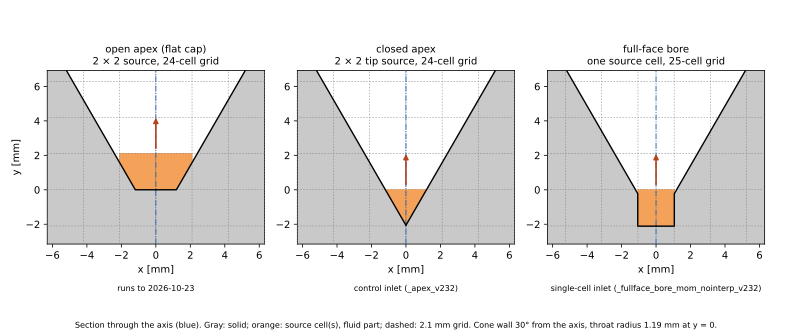

# 3. Geometry and mesh

## Coordinates and vessel

y is up and the vessel axis is x = z = 0. y = 0 is where the cone reaches
the nozzle diameter. The vessel is a surface of revolution:

| Part | Dimension | Source |
|---|---|---|
| Cone | wall radius r = R_t + y·tan 30°, throat R_t = 1.19 mm (nozzle 2.38 mm); cone top at y = 41.6 mm | C26 (60° cone); throat = nozzle is assumed |
| Column | R_c = 25.2 mm (D = 50.4 mm = 24 × 2.1 mm) up to y = 0.21 m | C26 p.3 says 50 mm; the 2025 paper says 50.8 mm |
| Outlet | pressure outlet over the top face at y = 0.21 m; STL top cap 5 mm above it | recipe |
| Below the cone | 4 blocked cell rows (jmax = 104 = 8 × 13, so the mesh splits evenly between ranks) | assumed |

The vessel is an STL surface written by Python (MFiX cut cells handle the
cone wall on a Cartesian grid). There are three builders, which differ
only in how the cone bottom is closed around the gas inlet. They are
selected with `run_C26_3d --stl-builder` (`params/geometry.yaml`
`stl_builder`).

| Builder | Cone bottom | Used by |
|---|---|---|
| `implicit` (`src/make_stl.py`): signed distance field + marching cubes, 77,088 facets | flat cap at y = 0, the "open apex"; the gas source sits on the cap | all runs to 2026-10-23 (`_massonly`, `_axisface`, `_momentum24`); still the yaml default so old decks regenerate unchanged |
| `parametric_apex` (`src/make_stl_c26_apex.py`): analytic 80-gon, 8,480 facets | **closed apex**: the 30° wall continues below y = 0 to its virtual apex at y = −2.06 mm, so the opening at y = 0 is exactly the nozzle area; the source fills the tip row y ∈ [−dx, 0] | the 2×2 control sweep (`_apex_v232`) |
| `parametric_fullface` (`src/make_stl_c26_fullface.py`): 8,816 facets | **full-face bore**: the closed-apex cone with a square bore, one cell wide, cut into its tip around the axis cell | the single-cell sweep (`_fullface_bore_mom_nointerp_v232`) |

How the parametric builders are built:

- **Facets.** 80 segments around, chosen so the faceting error is ≤ 0.1 of
  a particle radius. Vertex azimuths are offset half a step so no vertex
  lies on a grid plane. Axial bands are at most 2 cells tall, because
  MFiX bins facets to cells by bounding box. The implicit builder's STL
  was coarsened from 311,640 to 77,088 facets (sampling step 0.25 → 0.5 dx)
  after DEM wall contact turned out to dominate run cost (3.5× faster, same
  cut cells).
- **The bore.** Its walls sit δ = 0.005·dx (10.5 µm) *outside* the source
  cell's faces. Every corner node of the source cell is then fluid, so
  MFiX treats it as an ordinary (uncut) cell whose only open face is its
  whole top face, dx² = 4.41 mm² against the nozzle's 4.45 mm². Its
  neighbors keep 0.59 % slivers, below MFiX's 1 % small-cell cutoff
  (`TOL_SMALL_CELL`), so MFiX blocks them and walls the source in.
  δ must also exceed `TOL_STL` = 1 µm. The 30° wall runs down until it
  meets the bore walls (y = −0.23 mm mid-side to +0.54 mm at the corners).
  The only horizontal surface is the bore floor.
- **A retired first bore** joined a square duct to the cone with a flat
  ledge at y = 0.75 mm. Parcels could rest on the ledge, and the smoke ran
  at 17 s of wall time per simulated ms. It was replaced the same day.

## Mesh

Uniform 2.1 mm cubes. C26 chose dx as the value closest to the nozzle
diameter (D_n/dx = 1.13), so the nozzle is about one cell. The domain is
24 cells across the column and 100 cells from y = 0 to the outlet.

Whether the vessel axis sits on a **cell face** (even cell count) or at a
**cell center** (odd count) decides what the gas source can look like:

| Layout | Box | Axis | Source footprint | Used |
|---|---|---|---|---|
| 27 cells | 24 + 1-cell margin each side + ½ cell each side | cell center | one axis cell | to 2026-10-20 |
| 26 cells | 24 + 1-cell margin | on the edge shared by 4 cells | 2 × 2 cells | 2026-10-21 (`--axis-on-face`) |
| **24 cells** | exactly D_c (column wall touches the box) | on a face | 2 × 2 cells | since 2026-10-22, the **control** (24 × 104 × 24) |
| **25 cells** | D_c + ½ cell each side | cell center | one axis cell | forced by the bore builder, the **single-cell inlet** (25 × 104 × 25) |

The 24- and 26-cell layouts have identical fluid cells (42,520, of which
8,608 cut). The 24-cell box matches C26's "24 cells across the reactor".
On a face-centered grid a nozzle-sized source snaps onto the 2 × 2 cells
around the axis. On a center-centered grid it is one cell.

### Cut-cell rules learned the hard way

- **A cut cell needs a fluid corner node.** MFiX classifies cut cells by
  their 8 corner nodes, so a fluid pocket whose corners are all solid is
  blocked. This is why a closed apex works only on the even grid: on the
  odd grid the single tip cell's corners (radius 1.49 mm) are all outside
  the 1.19 mm throat, and a point source there aborts with
  `PS_VOLUME == ZERO`. The bore exists to give the odd grid a source
  cell.
- **MFiX cuts the apex tip as a tetrahedron.** The four closed-apex tip
  cells get 64 % of their true volume, so the effective opening is
  ~2.8 mm², not 4.45. The tip jet runs at ~70 m/s instead of 45.
- **Small cells remain.** After the 1 % cutoff, sliver cells of 1.3–1.8 %
  of a cell still line the cone wall (smallest 1.35 % on the bore mesh).
  One parcel (3.7e-10 m³) is larger than such a cell. This is why the
  gas-fraction floor cannot be removed (file 05).
- **MFiX 23.2 deletes parcels at some cut-cell corners.** On the closed
  apex this is ~22 parcels/s at y = 27.3 mm, r = 16.5 mm. 26.1.2 has a
  guard against it; 23.2 does not. Turning off `remove_rogue_particles`
  only makes it fatal. Check the first-vs-last parcel count on every 23.2
  run; losses stay ≤ 0.5 % of the bed.
- **A literal point snaps off-axis.** MFiX maps a zero-width point source
  to the cell whose face is nearest. On the face-centered grid that is the
  −x/−z cell, 1.5 mm off the axis. Point-source regions are therefore
  written as cell faces.

### What a finer mesh would cost

Resolving the nozzle with 4 cells needs dx ≤ 0.6 mm, about 2.6 M cells
(35× C26's mesh). It would also break the coarse-graining (parcels of
0.89 mm in sub-mm cells). Grids finer than 2.1 mm and W < 10 are out of
scope (user decision).

### Partitioning

Runs use 4 MPI ranks split 2 × 1 × 2 in x and z (gridmap `[12,12]` on the
24-cell box). On AWS this gives the best throughput per vCPU and lets
8 jobs fit the 32-vCPU quota. Non-uniform gridmaps and more ranks were
slower.
